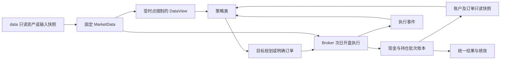

# 回测架构

回测层把策略类的决策转为可核对的账户变化。策略不维护交易账本，回测不包含某个策略的选股、ATR 阈值、冷却期或持仓天数算法。

## 数据流与责任

策略单向导入公共接口，引擎不导入具体策略目录。调用方显式传入类；实例、参数副本、账户、订单和随机数状态按运行隔离。市场输入可在多策略或参数比较之间共享。

| 文件 | 责任 |
|---|---|
| `models.py` | 数据需求、目标、订单、事件和不可变快照 |
| `strategy.py` | 生命周期及策略上下文 |
| `config.py` | 与策略参数独立的执行配置 |
| `data.py` | 复制后的输入、内容指纹、时点视图、canonical 加载与输入快照 |
| `engine.py` | 交易日循环、回调时序、运行隔离与失败结果 |
| `planning.py` | 全量目标转差额订单，撤销过时目标 |
| `execution.py` | 有效期、拒单、撮合、部分成交和稳定排序 |
| `capacity.py` | 每股每日共享的历史成交额容量预算，不使用当天未来成交额 |
| `account.py` | 整数分现金/成本、FIFO 批次、应收权益和账本 |
| `actions.py` | 已支持权益的分配与到账政策 |
| `rules.py` | 价格分取整、板块数量约束 |
| `costs.py` | 成交日期费用、固定不利滑点及已被旧策略使用的辅助入口 |
| `metrics.py` | 完整账户曲线和独立基准处理 |
| `results.py` | 标准结果、失败结果及原子目录发布 |
| `experiments.py` | 策略比较与参数笛卡尔积 |
| `tests/backtest/example_strategies.py` | 仓库测试专用契约 fixture，不进入应用安装包 |
| `__main__.py` | 显式策略类、输入与结果命令入口 |

## 策略契约

策略通过 `on_close` 返回决策，生命周期可选初始化、执行回报和结束诊断。上下文中的账户、批次、订单是不可变快照；行情与特征返回副本。策略类自己的峰值、冷却期和止盈状态不进入公共账户，只能根据实际回报确认执行结果。

输入声明区分 `targets` 与 `orders`。目标是完整组合权重；`None` 不产生新目标，空组合请求清仓。目标规划仅使用信号时已知权益与收盘价格。明确订单使用真实股数或含费买入预算，并可指定批次、有效期和标签。两者共用 Broker、账户和绩效，不存在两套成交回测循环。

框架保留通用标签和持仓批次，策略负责自己的决策。特征输入按声明的可得时间读取，训练与标签构建不进入资金循环。

## 时钟

收盘决策至少在下一交易日开盘执行。完整市场日历驱动，包括无信号、无个股行情的日期。

每个交易日：

1. 结算到期权益，确认本日可处理的持有人权益。
2. 对上一期现金计入声明的自然日利息。
3. 执行已生效订单，先卖后买，随后按优先级、证券和订单标识排序。
4. 收盘估值并记录账户、持仓和收益；缺价标记 stale。
5. 回报执行和权益事件；只允许策略更新私有状态。
6. 进行收盘决策，生成后续订单。

预热不足在启动前失败，不移动请求区间。存在前一交易日数据时，初始化后可生成起始日前收盘决策；没有前一日时初始化视图在首日开盘前，无法读取首日完整行情。最后一个收盘仍可产生订单，但区间内不会虚构之后的成交，结束事件通知策略并标记 `open_at_end`。

## 账户不变量

- 持仓股数为整数，现金、费用与成本为整数分。
- 普通买入批次的可卖交易日为成交下一交易日，独立于信号延迟。
- 卖出只从指定或 FIFO 可卖批次扣除，不允许空头；现金不足只能部分成交、递延或到期，不能透支。
- 未完成卖单不增加可用现金，未完成目标不替换真实持仓。
- 权益等于现金、持仓市值及应收权益之和。
- 分红应收不是可用现金；送股未到账数量不进入可卖持仓，但已确认权益可以估值。
- 成本在批次和送股应收之间转移，不能凭新增股数重复增加原始成本。

未知持有人权益若影响现有持仓使运行失败，保留位置和部分记录。框架不能只冻结成交、同时继续计算漏掉权益的净值。

## 数据和复现

canonical 加载先检查最新批次成功和审计有效，拒绝结构性行情错误及超出审计观测日的请求。加载阶段持有共享发布锁，写入任务不能并发修改输入；还检查批次是否在锁取得前变化。

输入加载后在内存复制固定，并对行情、股票主表、日历、特征和基准计算内容指纹。受限视图使用日期范围及按证券索引，截面直接读取当日表，避免每次全历史扫描。特征声明 `available_at`，可附加模型/标签可得时刻。公共 API 限制日期，不能为策略主动读取外部未来数据提供进程沙箱保证。

运行 ID 包含执行配置、策略参数、代码身份、实际输入和环境条件。策略定义模块之外的辅助文件通过 `code_dependencies` 显式声明；未声明的外部依赖无法自动推导完整代码版本。精确重现可以将输入随结果保存，再用 `MarketData.load_snapshot` 或 CLI 的 `--snapshot` 加载，指纹不匹配时拒绝。

结果先写入临时目录再发布，已有目录不覆盖。批量结果保存相同方式发布，并可只保存一份共同输入。运行异常抛 `BacktestError`，其中保存失败处部分结果，标准绩效为空。

## 已实现范围与限制

当前为日频、多头、现金、次日开盘模型，支持全量目标、明确订单、部分成交、有效期、指定批次、原始价格成交和统一统计。基准缺口不删除账户日期，初始资金是收益及回撤基点。

公司行为支持明确能力下的现金/送股权益。严格到账政策需要到账和可卖日期；研究近似政策显式选择除权日到账。固定股息税、固定或已声明可得时间的日度现金代理收益、送股取整均记录为假设，不能声称复现完整税务/结算过程。现金日度观测只使用上一交易日收盘已经可得的该日记录，缺失保留可见标记，不以未来或前填数据补息。配股认购、未知权益、融资、空头、期货和盘中撮合不属于当前实现。

data 的财报最新修订、前复权快照、部分历史分类区间及量单位边界仍然存在；回测框架不将其转化为完整历史版本库。

`strategy/demo` 是唯一公开策略类示例，使用此引擎处理账户与执行。费用、统计及明确策略类的公共接口可以独立使用。
