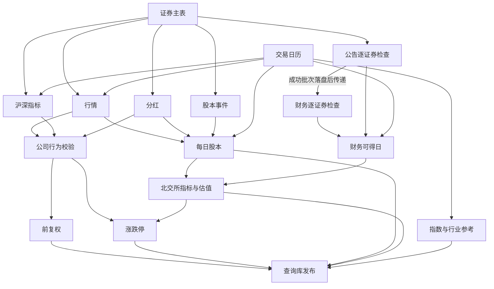

# 架构

数据层提供可检查的市场事实和查询接口。设计目标是可靠地补齐缺口、吸收供应商修订、避免重复工作，并让研究代码只依赖清晰的数据语义。

## 数据流

```text
外部源 / 显式导入
        ↓
源规范化与逐证券合并
        ↓
canonical Parquet
        ↓
复权、涨跌停、股本、财务可得日等派生资产
        ↓
质量检查 → DuckDB 逻辑视图
```

Parquet 是持久数据资产，catalog 是这些资产的查询定义。不会为了日常更新再复制一套 warehouse 宽表。原始公司行为与标准化可计算事件、raw 与 qfq、股本事件与每日股本分别表达不同事实或计算结果，因此分开维护。

## 代码边界

| 模块 | 责任 | 依赖方向 |
|---|---|---|
| `sources/` | 请求、限流、源字段转换、增量合并 | 基础存储、交易日历和通用规则 |
| `assets/` | 基于本地事实推导复权、涨跌停、股本和估值 | 源资产和通用规则 |
| `rules/` | 价格精度、公司行为公式及其可计算性 | 不依赖管线或研究策略 |
| `research/` | 财务可得日、查询视图、数据质量检查 | 标准化与派生资产 |
| `pipeline/` | 依赖计划、执行、成功记录、恢复和计时 | 调用各域的公开构建/更新函数 |
| `__main__.py` | 命令和参数校验 | 管线及显式维护操作 |

源特有的请求、转换和发布放在一个模块，避免按函数种类过度拆分。共享的存储、成功记录和月份调度只实现一次。复权和涨跌停共同使用除权参考价计算，放在 `assets/adjustment_limits.py`，避免金融公式复制。

基础模块：

- `paths.py`：唯一数据路径定义。
- `runtime.py`：配置、限流和重试。
- `storage.py`：保留数据 JSON 序列化、Parquet 相同内容不重写和写锁 PID 契约；底层原子文件替换及排他锁由 `ashare_alpha.storage` 共用。
- `calendar.py`：从已覆盖的交易日历解析目标日；过期日历不能冒充当前交易日。
- `parquet_metadata.py`：优先从 Parquet footer 读取日期范围，没有统计信息才读日期列。
- `incremental_files.py`：证券选择和逐日合并。

源模块按数据主题命名。`fetch_windows.py` 计算长时间停更后的请求范围；`market_events.py` 共享分红、股本的变化检测、历史刷新和定期核对；`monthly_disclosures.py` 共享龙虎榜/大宗的月份调度。`pipeline/tasks.py` 是唯一增量任务注册表，`pipeline/identity.py` 声明相关代码和语义配置，`pipeline/maintenance.py` 注册初始化、修复和外部导入操作。

## 更新计划与恢复

1. CLI 确定目标日期、任务和证券范围。
2. 计划器展开依赖，只比较该任务相关代码、语义配置和输入/输出文件指纹。请求预算、重试次数、队列批次和其他域配置不导致已验证事实失效。
3. 更新取得 OS 写锁，同一时刻只允许一个数据发布进程。
4. 将依赖已完成的任务加入进程池，默认最多同时运行 4 个任务；执行前重新检查输入，已成功且未变化的工作跳过。
5. 每个任务使用独立源会话，逐证券抓取另有受限并发。调度器按资源组约束 BaoStock 和东财大批量请求，避免任务叠加破坏会话或放大源站压力。
6. 源更新和派生计算分别记录逐证券成功结果；异常退出后复用已完成证券。公告成功批次落盘后通过进程队列交给财务，默认每 50 只传递一次，财务不用等公告整任务结束。失败证券不进入财务；成功证券仍可处理并保存恢复记录。
7. 父进程统一发布任务成功记录和批次状态。财务在公告输入全部完成后计算最终任务签名；任一证券未完成时不推进任务整体成功日期。查询库等待本批次所有选定任务结束，包含可选数据源。`--parallel-tasks 1` 使用串行依赖调度。
8. 批次状态、错误和耗时写入 `state/runs/`，完整数据检查结果写入 `quality_report.json`。

`state/tasks/subsets/` 保存局部任务结果，不能代替全市场成功记录。`state/fetch_receipts/markets/` 保存分红、股本的全历史检查日、增量检查日、文件指纹和中断进度，子集使用独立记录。`checked_through` 表示源检查范围，不表示每只股票都有该日成交记录。

任务实现版本与已验证源事实的版本分别维护。更新任务编排、队列处理或查询代码时，已成功的源事实不会因此重新抓取；源解析或请求范围规则变化仍会失效。派生计算按相关计算模块和共享金融规则失效。

批次从开始时就保存 `running`、进程和 `current_tasks` 列表，结束时保存成功/失败状态；兼容字段 `current_task` 为其中首个任务。`pipeline/status.py` 提供只读进度，结合写锁识别中断并标记历史审计；界面不自行根据行情最大日期推断更新完成。`pipeline/acceptance.py` 编排实际更新、失败续传、重复执行和最终审计，结果保存在 `state/acceptance.json`。

并行任务关系：



图中列出主要数据依赖；完整依赖和互斥资源组以 `pipeline/tasks.py` 为准。

主表通过带超时和分页完整性检查的当前名单更新，保留历史退市及非活跃证券，不因源暂时缺少名称而删除资产。官方名单、已有已核实日期及 BaoStock 补齐上市日期；无法确定退市日期的历史证券使用 `inactive` 标记。

目录下已有的 `purged_no_bars_securities.json` 是主表排除清单；`corporate_action_event_coverage.json` 是公司行为可恢复记录；`catalog_coverage.json` 是当前视图构建结果。更新还会生成源诊断报告。不存在的运行目录在实际执行时创建。

## 不定时补数与修订

- **分红与股本**：先按公告日期和事件生效日期检查重叠窗口。与本地值一致的检测行不触发历史刷新；变化证券请求完整历史后替换，处理更正日期、撤销和删除。首次全市场初始化与默认每 30 天的核对读取全市场历史；首次子集只请求所选证券；新证券或文件不可信时单独回填。空增量窗口是明确成功，空全市场历史响应仍是失败。失败不推进源检查日，已成功证券可以续传。
- **公告**：从上次成功检查日重叠七天续接；首次从配置起点读取。空分页必须是明确的成功响应，不能将限流或格式错误解释为无公告。成功记录先落盘，再发送给财务。
- **财务**：定期检查，新公告变化也触发检查。请求期数随缺口扩大，完整的新观测替换同主键旧值。任一三表请求失败不覆盖旧文件。
- **行情和指标**：从每个证券已有末日继续；`--refresh-from` 允许重新检查更早日期。显式指定证券可包含退市股。北交所供应商 qfq 在重叠 OHLC 被修订时重拉完整历史，避免拼接不同复权基准。
- **派生资产**：按证券比较输入变化，维护包括非活跃和退市证券的已有历史。日期前移本身不导致全部重算；公司行为影响历史复权时仍按完整序列计算。北交所日度指标和估值依赖已完成的股本日序列，不能在旧股本上先计算新行情估值。
- **月份披露**：龙虎榜/大宗覆盖停更期间每个月，保留重叠窗口，截止到目标日期；失败月份阻止不完整结果发布。

公司行为是复权和涨跌停的必要依赖，不以省略事件更新换取速度。沪深使用校验事件，北交所涨跌停使用披露分配公式并检查实际 OHLC 边界，首个上市交易日不设置标准涨跌幅限制。北交所不因此获得沪深同等程度的公司行为参考价校验。部分源只提供最新快照；维护截止日期不等于历史版本隔离。

## 性能机制

分红和股本以全市场日期窗口检测变化，再按证券刷新完整历史。首次初始化和定期全量核对采用市场分页后按证券分发。不能通过只合并新增行处理所有更正，变动证券必须重新检查完整历史；窗口外未改变公告日期的修订由定期核对发现。来源窗口的北交所旧代码仅在代码尾号与证券简称一致时识别到当前代码。

分红任务保存成功截止日期和文件指纹，事件任务匹配后复用，避免连续两次下载同一批历史。同值整数/浮点表示差异不导致事件文件重写。主表已经获取上市日期时，不重复请求同一批交易所名单。

完整链路对沪深证券抓取 raw，再用已验证事件计算 qfq。BaoStock 用独立进程复用会话，日度指标同时抓取原始 `preclose`。历史参考价缓存与新增指标完整覆盖行情日期时，公司行为校验直接读取本地；缺口或强制检查才回源。参考价读取及事件校验采用最多 4 个独立进程，逐证券原子发布，父进程保存成功记录；会话在进程结束时关闭。普通无事件日期用向量运算排除，逐行处理仅用于事件和异常。

相同内容不改写文件，从而保留下游指纹。计划器在一次未变化执行中共享文件列表及 stat；有任务正在写入时，重新观察计划所需文件，任务完成后清空缓存。普通依赖等待上游结束，公告/财务队列保证接收的每只证券已经完成公告与成功记录发布。金融请求预算在所有接收批次间共享，不能以增加批次数绕过限流。事件记录保存各证券的签名与诊断摘要，避免收尾时重新扫描全部事件产物。

日期范围查询使用 footer 和文件签名缓存。历史指数成员快照按“指数 + 日期”判断缺口，指数行情和资金流请求增量窗口。

这些机制减少请求与计算量；实际联网总耗时仍受首次回填、配股查询和上游限流影响，实测边界见 [验证依据](VALIDATION.md)。

## 发布与研究使用

股本事实从可信源的生效日开始向后延续，首次记录之前保留 NULL，不以未来股本回填历史。总市值和流通市值分别使用对应股数与未复权收盘价，不互相替代，也不在查询层生成无来源标签的成交额/换手率代理值。沪深复权与涨跌停必须读取已校验事件，缺事件文件时失败；北交所涨跌停继续使用声明分红公式。未知 ST 在影响规则的日期不推断为非 ST；无参考价与规则不限幅分别标记。不可用边界的涨跌停标记保持 NULL。

文件先写到同目录临时文件，再原子替换。catalog 在临时数据库中构建，完成视图和主键检查后发布；失败保留原库，不积累无数据隔离能力的 catalog 副本。

这不是跨所有 Parquet 的事务快照：源文件更新期间，已有视图可能看见不同资产的更新进度。研究应在更新结束并通过所需质量检查后启动。精确复现跨更新批次的历史回测需要冻结实际输入数据，单独复制 catalog 无法做到。

数据层不定义因子、股票池或组合参数。后续研究根据查询契约和质量标记选取数据，不能把供应商最新修订快照或快照推导的行业区间当成完整历史可得版本。
