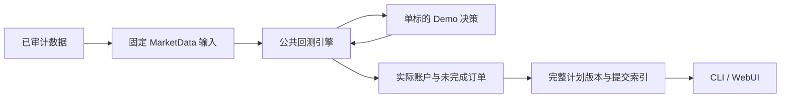

# 策略与输入架构

公开策略只保留 `strategy/demo`：单标的买入并持有。数据和实际研究产物从本地工作区读取，其他策略不会注册或发布。

`demo/params.py` 只接受一个代码；`strategy.py` 发出买入请求，持有后不产生卖出或新调仓请求。策略通过只读快照观察账户，不自行计算成交、现金或可卖股数。

`demo/build.py` 固定所选标的的原始执行行情、主表、日历和基准。查询在当前成功审计及共享读锁下完成。输入快照校验内容指纹，不依赖更新后的查询库重放。

`research/` 提供通用输入读取、内容身份和标准运行发布工具。策略实例、账户、随机数和参数按运行隔离。CLI 日计划保留引擎终点未完成订单，买入预算含费；请求卖出不会释放未成交现金。

完整计划先写入不可变版本，再原子更新索引；订单、持仓、信号日、执行日和输入身份一起提交。框架的日期、费用、T+1、权益及未来信息限制由独立测试验证，demo 不把持有收益当作策略有效性的证明。
